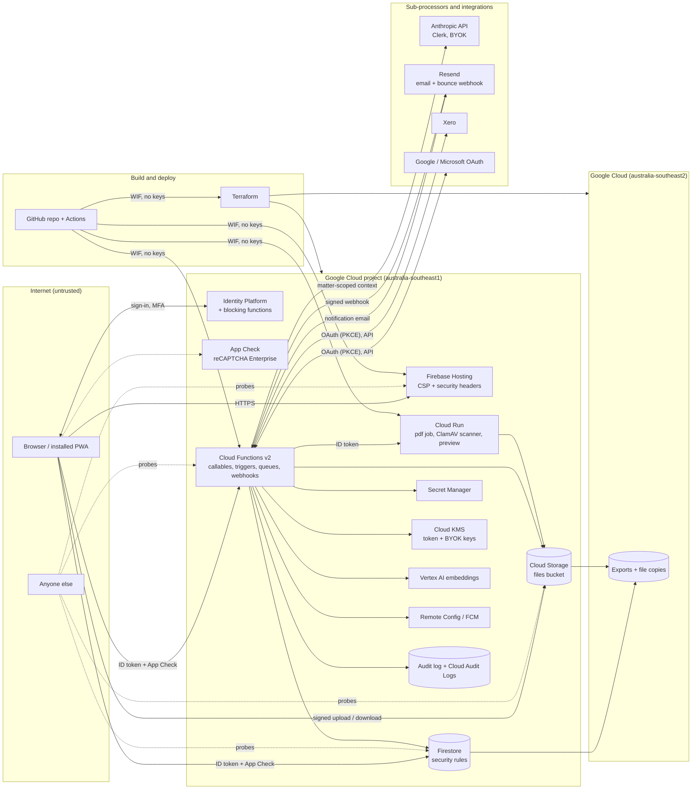

# Threat model

> SEC-02. A living STRIDE model of Materia v2. **Review it every quarter** (next: January 2027) and whenever an ADR adds a component, a sub-processor or a trust boundary. Each review adds a row to the log at the end. The product owner signs off each review (SEC-02a).

Materia holds confidential, often privileged, client information for an Australian wills and estates practice: health details in capacity disputes, family and financial details, identity documents. The assets that matter most, in order:

1. **Matter data and documents**, including privileged material (`privileged: true`).
2. **Credentials and keys**: sessions, MFA factors, recovery codes, OAuth refresh tokens (Xero, Google, Microsoft), each org's own Anthropic key (BYOK), service account credentials.
3. **Integrity of the record**: the audit log, computed deadlines, invoices and their numbering.
4. **Availability** around legal deadlines (reminders, the Deadlines screen).

## Data flow

Trust boundaries are the dashed boxes. Everything inside "Google Cloud (australia-southeast1)" runs in the environment's own project; backups are in australia-southeast2.

## STRIDE by element

S spoofing, T tampering, R repudiation, I information disclosure, D denial of service, E elevation of privilege. Tickets are the Linear keys that own each mitigation.

| Element | Threats | Mitigations (ticket) | Residual risk |
| --- | --- | --- | --- |
| **Browser / PWA** | S: stolen session on a shared or lost device. I: cached matter data left behind. T: a modified client skipping UI checks. | Idle timeout and maximum session length per org, remote sign-out and session list (SEC-04). Sign-out clears Firestore's IndexedDB caches and per-user storage; "shared computer" uses session persistence (FND-16). Every check that matters is server-side (rules, callables); the UI only mirrors them (ADR-006). | A device compromised while signed in. |
| **Firebase Hosting** | T: XSS or injected script. T: clickjacking. I: source maps exposing code. | Enforced CSP with hashed inline scripts only, `frame-ancestors 'none'`, `X-Frame-Options: DENY`, `nosniff`, a strict referrer policy (FND-22). `csp check` fails a build with an unhashed inline script. Source maps are not deployed (`**/*.map` ignored; private maps for `decode-stack`, FND-21). | `style-src 'unsafe-inline'` (Angular component styles). No HSTS header until a custom domain (`*.web.app` is preloaded). |
| **Identity Platform** | S: credential stuffing, phishing, account enumeration. S: sign-up by strangers. E: MFA bypass through recovery. | 12-character minimum and breached-password check, email-enumeration protection, invite-only sign-up (`auth-beforeCreate`), TOTP MFA enforceable per org with a grace period, recovery codes as scrypt hashes, rate-limited (5 per 15 min) and audited (FND-16, SEC-04). | Phishing of a TOTP code in real time (no passkeys yet). |
| **App Check** | S: scripted clients calling the backend directly. | reCAPTCHA Enterprise App Check enforced on callables, Firestore and Storage; debug tokens only in dev (FND-22). Prod key and enforcement are on the prod release checklist. | App Check raises cost for automation; it doesn't authenticate users. |
| **Firestore + rules** | E: cross-tenant reads or writes. E: a member writing fields they shouldn't (role, status, privileged). I: privileged material to read-only roles. T: audit log edits. | Default deny; every org path checks the claim **and** an active member document (`inOrg`, ADR-021); field whitelists generated from `libs/domain` (`rules-sync`); `privileged.view` checks; the audit collection has no client access (FND-14, FND-18, CORE-10b). Tests: the generated per-collection, per-role suite with cross-org denials, and a **rules fuzz test** of random paths, identities and operations (SEC-02, `firebase/tests/rules-fuzz.spec.ts`). | The 1000-expression evaluation cap: rules near it (Clerk messages) can fail closed for legitimate reads; checked before adding permissions. |
| **Cloud Functions (callables, triggers, queues)** | S: forged caller. T: malformed input. R: "I didn't do that". I: data in logs. D: expensive calls in a loop. E: role checks skipped. | `defineCallable` checks auth, the org claim, an active membership (cached 60 s), the role, App Check and a zod schema; idempotency by `requestId` (FND-15). Re-authentication within 5 minutes for exports, deletes, role and security changes (SEC-04). Semantic audit entries plus trigger capture of every org write (FND-18). Structured, redacted logs: ids only (FND-21). Cloud Tasks rate limits; Clerk token budgets and kill switches (AI-02). | Per-user rate limiting of ordinary callables relies on App Check and budgets, not a quota per user. |
| **Webhooks (Resend bounces)** | S: forged delivery events marking addresses undeliverable. | Shared-secret / signature verification before any write; only marks email preferences (FND-20, FND-20b). | Low impact by design. |
| **Cloud Storage** | T: malicious upload (malware, macro documents, polyglots). I: guessed or leaked file URLs. E: writing outside one's own upload area. | Uploads go to `pending/`, are type- and size-checked, scanned by ClamAV and only then readable; infected files are quarantined; Office macros flagged (CORE-12, CORE-12a, ADR-028). Storage rules mirror the Firestore checks; downloads are short-lived signed URLs or rule-checked reads; `Content-Disposition: attachment`, no inline HTML. | Zero-day malware ClamAV doesn't detect. |
| **Cloud Run (pdf job, scanner, preview)** | E: a crafted Office/HEIC/PDF exploiting LibreOffice, Chromium or qpdf. I: a compromised container reading other data. | Private services invoked with ID tokens by the functions runtime only; non-root containers; one file per request; images rebuilt with `apt-get upgrade` on every deploy and **scanned with Trivy in CI** (fixable high/critical fail) (FND-24, CORE-12a, SEC-02). Templates escape all fields before HTML→PDF. | Container escape via an unpatched LibreOffice bug between rebuilds. |
| **Clerk gateway → Anthropic API** | I: privileged or out-of-scope data sent to the model or shown to the wrong person. T: prompt injection from uploaded documents steering Clerk. I: cross-border processing (APP 8). S: theft of an org's own API key. | Server-side context assembly scoped by role and privilege, untrusted-document framing, read-only tools, suggestions a person accepts instead of writes (AI-03, ADR-034, ADR-037). Evals with privilege-leak and injection graders gate prompt changes (AI-12). No prompt or completion text in logs. BYOK keys KMS-encrypted, never returned to clients (AI-02a, ADR-011b). Processing outside Australia accepted for the MVP (ADR-011a); listed as a sub-processor (SEC-01). | Novel injection techniques; model provider retention terms (SEC-01 sign-off). |
| **Vertex AI embeddings** | I: document text leaving the region. | `australia-southeast1` endpoint (ADR-012). | — |
| **Resend (email)** | I: matter content in email. | Notification emails carry titles and links, never privileged content or document text; privileged items are never emailed without an explicit action (handbook non-negotiables, FND-20). | Recipient address and subject are processed in the USA (sub-processor list, SEC-01). |
| **Xero, Google, Microsoft OAuth** | S/I: token theft, CSRF on the callback, over-broad scopes. | Server-side OAuth with PKCE and a single-use `state`; refresh tokens encrypted with Cloud KMS in documents clients can't read; per-user connect; revocation on disconnect and member removal (INT-01, ADR-051, BILL-09, SEC-05). | A compromised integration account at the provider. |
| **Secret Manager / KMS** | I: secrets in code, logs or Firestore. | Secrets only via `defineSecret`; gitleaks on every change with custom rules for service account keys (JSON and base64), Anthropic and Resend keys (SEC-02, `.gitleaks.toml`); least-privilege service accounts (FND-03, CORE-12a). | — |
| **Backups (australia-southeast2)** | I: a second copy of everything. T: restoring a destroyed matter. | Separate buckets with uniform access and no public access; PITR, managed backups, exports and file copies with fixed retention; restore drills must not resurrect destroyed matters (SEC-03, CORE-19). | Destroyed data persists in backups until they expire (stated on certificates). |
| **CI/CD and supply chain** | T: a malicious dependency or action. T: a deploy from a laptop. I: secrets in the repo. | GitHub-owned actions only; CLI tools pinned and checksum-verified; `pnpm audit` gate; CodeQL (security-extended) daily; gitleaks; Trivy image scans; checkov on Terraform; Dependabot grouped weekly; a CycloneDX SBOM on every release (SEC-02). Deploys only from Actions through Workload Identity Federation (no keys), prod behind a release tag and approval (FND-05). `ci-ok` required on `main`. | Actions are pinned by tag, not SHA (GitHub-owned only). A compromised maintainer account. |
| **People** | E: an insider at the firm. E: the operator's own cloud access. R: denial of an action. | Roles, privileged access, audit log of every mutation, re-auth for exports (FND-17, FND-18, SEC-04). Cloud Audit Logs record data access (DATA_READ/DATA_WRITE on all services). Org export and deletion are owner-only with typed confirmation (SEC-05). | The operator (a single owner) holds project-owner access; mitigated by audit logs, not by separation of duties. |

## Top risks

| # | Risk | Likelihood | Impact | Key mitigations | Owner tickets |
| --- | --- | --- | --- | --- | --- |
| 1 | **Cross-tenant access**: one firm reads another's data | Low | Critical | Org claim + active membership on every path; collection-group rules check `orgId` in the data; per-collection cross-org tests; rules fuzz test; callables re-check membership | FND-14, FND-17, SEC-02 |
| 2 | **Privilege leakage through Clerk**: privileged or out-of-scope content in an answer, a log or the provider | Medium | High | Server-side scoping, privilege filters, suggestions-only writes, injection framing, privilege-leak evals, no prompt text in logs | AI-03, AI-12, ADR-034 |
| 3 | **OAuth token theft** (Xero, Google, Microsoft) | Low | High | Server-side PKCE flow, KMS-encrypted refresh tokens, no client read path, revocation | INT-01, ADR-051 |
| 4 | **Malicious uploads** (malware, exploit documents) | Medium | High | Pending area, ClamAV scan before anyone can read, private conversion services, image scanning, attachment-only downloads | CORE-12, CORE-12a, SEC-02 |
| 5 | **Insider access** at the firm or the operator | Medium | High | Least privilege by role, privileged flag, audit log, re-auth for exports, Cloud Audit Logs | FND-17, FND-18, SEC-04 |
| 6 | **Supply chain**: a compromised npm package, action or base image | Medium | High | Lockfile, `pnpm audit`, CodeQL, Dependabot review, Trivy, SBOM, checksum-pinned tools | SEC-02, FND-04 |
| 7 | **Account takeover** of a lawyer | Medium | High | MFA required per org, breached-password check, session limits, remote sign-out | FND-16, SEC-04 |
| 8 | **Data loss** or ransomware-style deletion | Low | Critical | PITR, daily/weekly backups, off-region exports, soft delete, destruction needs an admin, drills | SEC-03, CORE-19 |

## Open items

These are known gaps, each with a home:

- External penetration test before GA, and its retest ([pentest plan](pentest-plan.md)): SEC-02a.
- Product-owner review of this model: SEC-02a.
- Pinning GitHub Actions by commit SHA (today: GitHub-owned actions by tag): revisit at the next review.
- Passkeys or phishing-resistant MFA: not planned for v1.

## Review log

| Date | Reviewer | Changes |
| --- | --- | --- |
| 2026-10-07 | Drafted (SEC-02) | First version. Waiting on the product owner's review (SEC-02a). |
